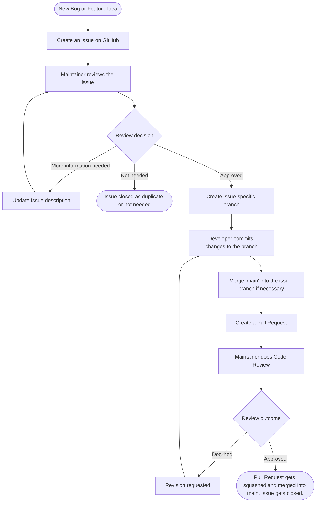

# Contributing

## General Workflow



## How Can I Contribute?

### Types of Contribution

| Type          | Meaning                                       |
|---------------|-----------------------------------------------|
| `feature`     | A new feature                                 |
| `bugfix`      | A bug fix                                     |
| `docs`        | Documentation-only changes                    |
| `style`       | Formatting, no logic change                   |
| `refactor`    | Code restructuring without behavior change    |
| `test`        | Adding or correcting tests                    |
| `chore`       | Maintenance tasks, build process, etc.        |

### Suggesting Changes

To suggest changes to this repository, create an issue on GitHub. Different templates are available depending on the type of change. Please choose a short but descriptive title. Where possible, also set an assignee, priority, and effort estimate in the issue fields.

#### Reporting Bugs

Before reporting a bug:

1. Check whether the bug has already been reported in the [Issues](../../issues).
2. If not, open a new issue including:
   - A short, clear description of the problem
   - Steps to reproduce
   - Expected vs. actual behavior
   - Screenshots (if helpful)
   - Environment details (OS, version, browser, etc.)

Note: not all of these points are required; choose what applies.

#### Suggesting New Features

Feature suggestions are welcome! Open an issue including:

- A clear description of the desired feature
- The problem it would solve
- Any alternatives you've considered

#### Adding a Task

Anything that does not fit under a bug or a new feature is filed as a Task Issue. Provide a clear explanation of what needs to be done and optionally define subtasks or add additional context.

### Contributing Code

1. Have an issue assigned to you
2. Create a new branch for your change:
   ```bash
   git checkout -b <branch_name>
   ```
3. Make your changes
4. Make sure existing tests still pass
5. Commit your changes (see [Commit Messages](#commit-messages))
6. Merge `main` into your branch if necessary (if your branch has conflicts or is behind main)
7. Open a Pull Request against the `main` branch

### Branch Naming Convention

The branch should be written in lowercase characters and formatted as kebab-case.

```bash
<type>/<issue-id>-<title>
```

Example:

```bash
bugfix/124-null-pointer-profile-loader
```

## Coding Standards

- Follow the existing code style used in the project
- Use clear, descriptive variable and function names
- Comment complex logic
- Add corresponding tests for new functionality

## Commit Messages

Use the commit messages to describe the changes you applied to the code within your commit. Use past tense (added, fixed,removed..etc) to emphasize **what you changed**. Each commit message is prefixed with a type and an optional scope of the change.

```
<type>(<optional scope>): <short description>

[optional longer body]
```

Example:
```
bugfix(auth): resolved login error on expired token
```

## Pull Request Process

1. Make sure your PR includes a clear description of what changed and why
2. Ensure all CI checks pass
3. Assign a maintainer to review your PR
4. The maintainer will review your PR and may request changes
5. Once approved, your PR will be merged using squash merge

### Pull Request Convention

Pull Request will be integrated into the main branch using squash merge. Therefore, the title of the Pull Request will be used as the commit message and must follow the same conventions.

```
<type>(<optional scope>): <short description>
```

For the Pull Request message, use the following template.

```
## Related Issue
Closes #

## Changes
-
```

---
