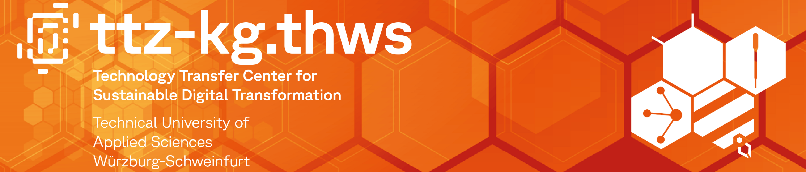

# Technologietransferzentrum Bad Kissingen

The Technology Transfer Center Bad Kissingen (TTZ-KG) is an institute of the Technical University of Applied Sciences Würzburg-Schweinfurt founded in 2023 with a focus on applied research in the field of sustainable digital transformation of laboratory analytics and medical technology. Thanks to a leading European cluster with a high density of laboratories, the Bad Kissingen location offers the best conditions for this. The goal is to facilitate technology transfer and retain skilled workers in the region by closely linking industry and science.
